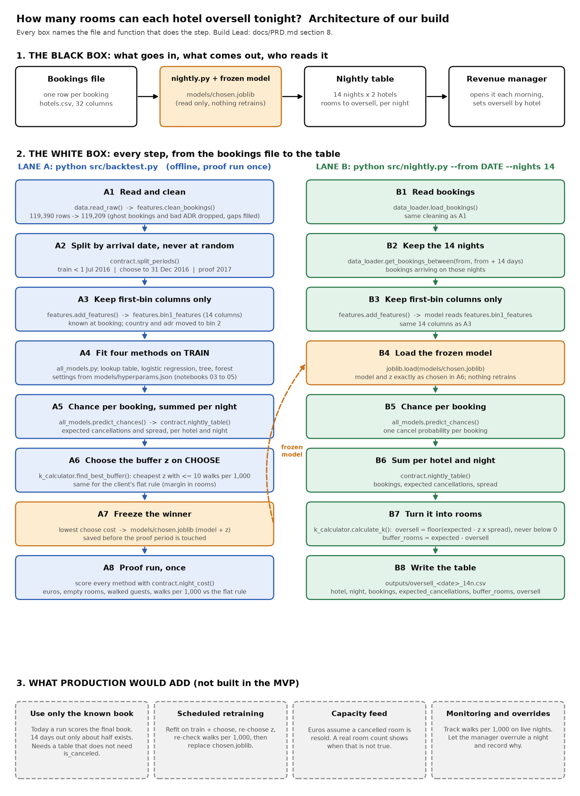

# What exactly are we building, and why this way?

**Owner:** Build Lead. **Closes:** ladder stages 3 and 5. **Length:** two pages and one diagram.

Write the options section on Wednesday, before the method table exists, and update it once the table is in. The architecture goes in on Thursday.

### 1. Who uses it, when, and what do they do with it?

> **Worked example.** The city operations lead opens the route table every evening, before routes are fixed, and adds the extra visits route by route. They overrule a route when a camp is cancelled at short notice.

**Our answer:** The group's revenue manager opens the table each morning. It has one row per hotel for each of the next fourteen nights. For each night they read how many rooms the rule says to oversell and enter that number in the booking system for the City Hotel and the Resort Hotel. They overrule a night when they know something the model cannot, such as a large group that has just called to cancel. The MVP does not record overrides yet; that is on the roadmap.

### 2. Which two ways could we decide, what does each cost, which do we choose, and what would flip it?

> **Worked example.** (a) A lookup table: the failure rate by booking channel and lead-time band, summed per route. Half a day to build, nothing to retrain. (b) A learned model of each booking's chance of failing, summed per route. Two days to build, retrained monthly. We choose (b) because it cuts idle slots by a further 9% with the guardrail met; we would flip to (a) if the gap fell under 3% on the next quarter's data.

**Our answer:** (a) A lookup table: the cancellation rate of past bookings in the same cell of hotel, deposit type and lead-time band, summed per night (`all_models.LookupTable`). It is cheap to build, a manager can read every rate in it, and it needs no tuning beyond the band edges. (b) A learned model of each booking's cancel chance (logistic regression, decision tree or random forest in `src/all_models.py`), summed per night. It takes longer to build and tune (notebooks 03 to 05) and has to be retrained as the booking mix drifts. In both cases the chances become a number of rooms in the same way, through the z-buffer in `src/k_calculator.py`.

We choose the learned model if it saves more euros than the lookup table on the choose period with the walk ceiling met, and we pick between the learned models on the same measure. The random forest won: on the choose period it cost EUR 1,193,673 against EUR 1,880,287 for the lookup table, a saving of EUR 686,614 (37%), at 9.03 walks per 1,000. We would flip to the lookup table if, after a retraining, the forest's choose-period saving over it fell below 10%, because then its extra cost to build, retrain and explain would no longer pay for itself.

### 3. What is our answer to the wish-list item?

_One paragraph with a number. Say which method the item would need and whether its output would change any number the client acts on._

**Our answer:** The wish is to find hidden guest types. That is a clustering job: group bookings by their first-bin columns without using the outcome and look at the groups. Our data already shows that guest types differ in what matters here: Groups cancel 61% of the time and Direct bookings 15% (`notebooks/01_baseline.ipynb`), and `market_segment` and `customer_type` are already inputs to the model. Clusters would change a number the client acts on only if adding the cluster label as a column lowered the choose-period cost with the ceiling met, and we have not run that test. Without it, the nightly oversell table would not change, so the item belongs to marketing's use of the data and not to this build.

### 4. What exactly is in the table the client reads?

> **Worked example.** One row per route and morning: route, date, slots booked, expected failures, buffer, extra visits to book, and a one-line reason.

**Our answer:** One row per hotel and night, written by `src/nightly.py` to `outputs/oversell_<date>_<nights>n.csv`: `hotel`, `night`, `bookings` (the bookings due that night), `expected_cancellations`, `buffer_rooms` (the rooms held back from the expected cancellations), and `oversell` (the rooms to sell beyond capacity). There is no one-line reason per row yet.

### 5. Which inputs do we use, by bin?

_Point to `docs/COLUMNS.md` and list here only the columns the method reads, each with its bin._

**Our answer:** All fourteen are bin 1, the columns known on the day of booking (`features.bin1_features`; the bins are in `docs/COLUMNS.md`): `hotel`, `lead_time`, `adults`, `children`, `babies`, `market_segment`, `distribution_channel`, `is_repeated_guest`, `previous_cancellations`, `previous_bookings_not_canceled`, `deposit_type`, `agent`, `company` and `customer_type`. No bin 2 or bin 3 column is read. The lookup table uses only three of them: `hotel`, `deposit_type` and `lead_time`.

`country` and `adr` were bin 1 until 17 November and are now bin 2. `country` looks corrected at check-in, and `adr` is built from transactions during the stay (evidence in `docs/COLUMNS.md`). The guest counts (`adults`, `children`, `babies`) stay in bin 1 with a caveat, because they can be amended before arrival.

### 6. Where do the numbers come from, and how is the buffer set and frozen?

> **Worked example.** Each booking gets a probability of failing; the probabilities are summed per route; the buffer is the number of slots subtracted from that sum, chosen on the choose period as the cheapest buffer that keeps the guardrail, then frozen for the proof period.

**Our answer:** Each booking gets a probability of cancelling from a model fitted on train only. `contract.nightly_table` adds the probabilities per hotel and night into `expected`, and also gives `spread`, the standard deviation of that sum if bookings cancelled independently. The oversell count is `floor(expected - z x spread)`, never below zero (`k_calculator.calculate_k`). The buffer is z. `find_best_buffer` tries z from 0.0 to 4.0 in steps of 0.1 on the choose period and keeps the cheapest z with at most 10 walks per 1,000, then `backtest.py` saves it with the winning model in `models/chosen.joblib`. The client's flat rule is handled the same way, with a fixed rooms margin from 0 to 60. Nothing is changed after that, and `nightly.py` only loads the file.

### 7. What is the error bill on the proof period?

_Euros, rooms and walks per 1,000 for the chosen rule and for the client's flat rule, from `python src/backtest.py`._

| Rule | Empty rooms | Walked guests | Walks per 1,000 | Cost (EUR) | Saving a month against the flat rule (EUR) |
|---|---|---|---|---|---|
| Client's flat rule | 8,179 | 151 | 6.07 | 3,934,243 | 0 |
| Our chosen rule (random forest, 14 columns, z = 0.9) | 4,084 | 62 | 2.49 | 2,040,111 | 236,766 |

Proof period: 1 January to 31 August 2017, eight months, 486 hotel-nights. The monthly saving is the total saving of EUR 1,894,131 divided by eight. Reproduce with `python src/backtest.py`; the full output is in `evidence/backtest_output.txt`.

**Both runs, because we changed the columns after seeing proof results.** Our first run used 16 columns, including `country` and `adr`. The same forest cost EUR 1,936,178 (3,708 empty rooms, 134 walked guests, 5.38 walks per 1,000), a saving of EUR 249,758 a month (`evidence/backtest_before_feature_change.txt`). We then moved those two columns to bin 2 (`docs/DECISIONS.md`). The honest rule costs EUR 103,933 more over eight months, leaves 376 more rooms empty, and walks 72 fewer guests.

These euro figures assume every cancelled room would have been resold. By our occupancy proxy, only 65% of City Hotel and 62% of Resort Hotel proof nights were near full (`evidence/full_night_share.csv`).

### 8. What does the system look like, first as a black box and then inside?

_Two drawings. The black box: what goes in, what comes out, who reads it. The white box: every step from the bookings file to the table, with the file or function that does it. Then list what production would add._

**Our diagram:** `docs/architecture.png`

Lane A (`python src/backtest.py`) runs offline: it fits the methods on train, chooses the buffer on the choose period, freezes the winner in `models/chosen.joblib`, then scores the proof period once. Lane B (`python src/nightly.py --from DATE --nights 14`) loads that frozen model and never retrains. Both lanes read the same fourteen first-bin columns (`features.bin1_features`).

**What production would add:**

- **Use only the known book.** Today a run scores each night's final book, so every booking counts as already made. Fourteen days before arrival only about half of it exists. The run needs a `nightly_table` that does not need `is_canceled`.
- **Scheduled retraining.** Refit on train and choose together, choose the buffer again, and check walks per 1,000 before the new model replaces `chosen.joblib`.
- **Capacity feed.** The euro figures assume a cancelled room is resold, which holds only when the hotel is full. A real room count would let the table say when it is not.
- **Monitoring and overrides.** Track walks per 1,000 on live nights, and let the revenue manager overrule a night and record why.

### 9. What are the limits?

> **Worked example.** Runs in under five minutes on a laptop; every number has a one-line reason; no patient name leaves the lab's systems.

**Our answer:** `python src/nightly.py --from 2017-08-18 --nights 14` runs in about one second on a laptop (0.94 s measured). It reads only the bookings file and `models/chosen.joblib`, and the model uses first-bin columns only. The data covers two hotels from July 2015 to August 2017, and the table scores each night's final book, not the book as it stood that morning. The table gives numbers without a reason per row, and the results are not tested on any hotel other than these two.

### 10. What could go wrong?

> **Worked example.** Camps cancelled at short notice cluster on the same routes; the failure rate drifts after a price change; route leads stop trusting the table after one bad morning.

**Our answer:** Three things. First, group bookings cancel together, so the spread, which assumes independent cancellations, understates the real uncertainty; Groups cancel 61% of the time in our data. The buffer z is chosen from the results, which absorbs some of this, but a big group cancelling on one night can still produce walks. Second, the booking mix moves: from train to proof the cancel rate rose from 35.8% to 38.7% and the non-refundable share fell from 15.3% to 10.2%, so a model fitted once will age. Third, the euro saving assumes a cancelled room is resold, and by our occupancy proxy only about 62% to 65% of proof nights were near full (`evidence/full_night_share.csv`).

### 11. What is out of scope?

**Our answer:** Room pricing, any hotel other than these two, a per-booking list for the front desk, the as-of-date run on the bookings known that morning (roadmap, week 7), hidden guest types (section 3), and the real room count of either hotel.
