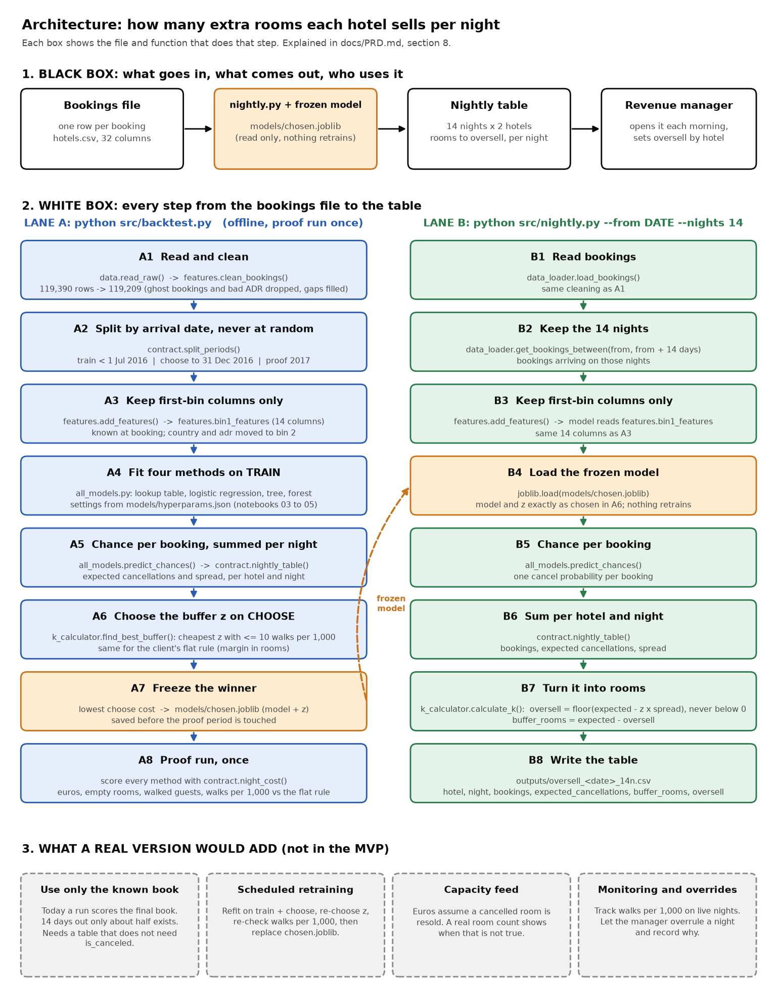

# Hotel overbooking: how many rooms can each hotel oversell tonight?

A cancellation-aware overbooking rule for two Portuguese hotels, a city hotel in Lisbon and a resort in the Algarve. For every arrival night it says how many rooms beyond capacity to keep selling, so cancellations stop leaving rooms empty, without walking more than 10 guests per 1,000 arrivals.

Built for IITGN Build 2 (Week 6). The client brief is in [`BRIEF.md`](C2_W06_Build2_Student_Pack/build2-starter/BRIEF.md).

## Result on the 2017 proof period

The rule was fitted on arrivals before July 2016, its buffer was chosen on July to December 2016, and it was tested once on January to August 2017.

| | Client's flat rule | Our rule (random forest) |
|---|---|---|
| Cost | EUR 3,934,243 | **EUR 2,040,111** |
| Rooms left empty by cancellations | 8,179 | **4,084** |
| Guests walked | 151 | **62** |
| Walks per 1,000 arrivals (limit 10) | 6.07 | **2.49** |

That is a saving of **EUR 1,894,131 over eight months**, about EUR 237k a month, with half the empty rooms and fewer walked guests. Full table: [`evidence/backtest_output.txt`](C2_W06_Build2_Student_Pack/build2-starter/evidence/backtest_output.txt).

## How it works



1. **Predict:** for each booking, the chance it cancels. The model uses only the 14 columns the hotel knows on the day of booking ([`docs/COLUMNS.md`](C2_W06_Build2_Student_Pack/build2-starter/docs/COLUMNS.md)).
2. **Add up per night:** sum those chances per hotel and night, giving the expected cancellations and their spread.
3. **Hold back a buffer:** oversell `k = floor(expected − z × spread)`. The buffer z = 0.9 is the cheapest value that stays inside the walk limit on the choose period.

We compared four methods (lookup table, logistic regression, decision tree, random forest) against the client's flat rule. The random forest was cheapest on the choose period and on proof.

## Run it

From `C2_W06_Build2_Student_Pack/build2-starter`:

```bash
python3 -m venv .venv && source .venv/bin/activate
pip install -r requirements.txt
python src/data.py                                   # downloads data/hotels.csv
python src/nightly.py --from 2017-08-18 --nights 14  # the morning table, from the saved model
```

`nightly.py` reads the saved model in `models/` and never retrains. `python src/backtest.py` rebuilds the model and reruns the proof period, so run it only when something has really changed. `pytest -q` checks the client's scoring rule. The full setup, including the notebook kernel, is in the [project README](C2_W06_Build2_Student_Pack/build2-starter/README.md).

## What's where

| Folder | What it holds |
|---|---|
| [`src/`](C2_W06_Build2_Student_Pack/build2-starter/src) | The pipeline: features, models, buffer, backtest, nightly table. `contract.py` is the client's scoring rule and is never edited |
| [`docs/`](C2_W06_Build2_Student_Pack/build2-starter/docs) | PRD, column audit, decisions log, build plan, roadmap |
| [`evidence/`](C2_W06_Build2_Student_Pack/build2-starter/evidence) | Saved outputs behind every number on the slides |
| [`notebooks/`](C2_W06_Build2_Student_Pack/build2-starter/notebooks) | EDA, the baseline, and hyperparameter tuning for each model |
| [`models/`](C2_W06_Build2_Student_Pack/build2-starter/models) | The chosen model and its tuned settings |
| [`outputs/`](C2_W06_Build2_Student_Pack/build2-starter/outputs) | The oversell table for 18 to 31 August 2017 |
| [`ai_logs/`](C2_W06_Build2_Student_Pack/build2-starter/ai_logs) | Every AI session we used, and what we kept or discarded |

## Things to know

- **No leakage:** `country` and `adr` were dropped as inputs because they can change after booking. With every column in, AUC jumps to a fake 1.000; with booking-day columns only, it is 0.798 ([`evidence/late_columns_auc.csv`](C2_W06_Build2_Student_Pack/build2-starter/evidence/late_columns_auc.csv)).
- **Saving is an upper bound:** the scoring treats every night as full, but only about half the nights were nearly full ([`evidence/full_night_share.csv`](C2_W06_Build2_Student_Pack/build2-starter/evidence/full_night_share.csv)). On quieter nights an empty room costs less.
- **The table uses the final booking list:** the 14-night table counts every booking for those nights as already known. A live version would score only the bookings on the books that morning.

## Branches

| Branch | Purpose |
|---|---|
| `main` | Final files and outputs |
| `dev` | Working branch with experiments and scratch work |
| `client`, `data`, `model`, `build` | Each team member's own work |
| `ai-benchmark` | An AI's own build from the starter files, kept for comparison and never merged |

## Data

Antonio, N., de Almeida, A. and Nunes, L. (2019). Hotel booking demand datasets. *Data in Brief*, 22, 41–49. CC BY 4.0. 119,390 bookings, July 2015 to August 2017. `src/data.py` downloads it; it is not committed.
